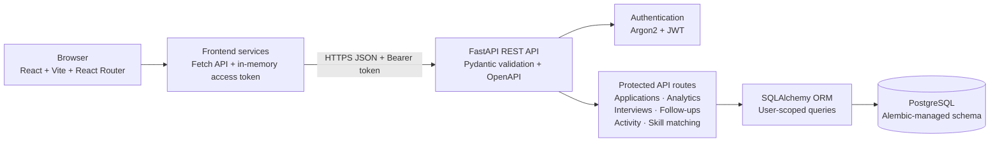

# Job Application Tracker

A full-stack job application intelligence platform built incrementally with React, FastAPI, and PostgreSQL.

## Current phase

Phase 12 packages the project for portfolio presentation and provides a Render Blueprint for a free demo deployment. The free database expires after 30 days and has no backups; no cloud deployment has been performed from this workspace.

## Project overview

Application Atlas is a private job-search workspace for tracking applications, interview rounds, follow-ups, recruiter activity, and job-skill comparisons. It includes a backend-calculated analytics dashboard and a transparent rule-based skill matcher; it does not claim to use AI or provide live job listings.

### Main capabilities

- Register and sign in with Argon2 password hashing and short-lived JWT access tokens.
- Create, search, filter, sort, edit, and delete account-owned job applications.
- Schedule interviews, store preparation notes and feedback, and manage follow-up reminders.
- Keep recruiter communications, notes, and status changes in an application activity timeline.
- View PostgreSQL-backed dashboard metrics, charts, upcoming interviews, follow-ups, and recent activity.
- Compare recognized job-description skills with skills you enter, then review missing terms and a resume-tailoring checklist.
- Use a responsive React interface with loading, empty, validation, and API error states.

See [DEPLOYMENT.md](./DEPLOYMENT.md) for Render setup instructions and free-tier limitations, [`render.yaml`](./render.yaml) for the service Blueprint, and [PORTFOLIO.md](./PORTFOLIO.md) for a resume-ready summary and interview preparation.

## Architecture



The skill matcher runs locally as deterministic, versioned rules; no AI service or job-board provider is connected.

## Run the frontend

Requirements: Node.js and npm.

```bash
npm install
npm run dev
```

Vite prints the local development URL after the server starts. To validate the frontend:

```bash
npm run lint
npm run build
```

## Frontend structure

```text
src/
  components/  Reusable interface pieces
  context/     Shared React state (authentication boundary)
  hooks/       Reusable React behavior
  layouts/     Shared page layouts
  pages/       Top-level screens
  services/    Backend API requests
  styles/      Global and page styling
  utils/       Small shared helpers
  App.jsx      Application composition
  main.jsx     Browser entry point
```

Routes are `/`, `/login`, `/register`, `/dashboard`, `/applications`, `/interviews`, `/reports`, and `/preparation`. The dashboard and workspace routes are protected by `ProtectedRoute`. The browser session starts signed out; login obtains a token and user profile before protected routes open. The dashboard loads live analytics from the backend and does not show fabricated data.

Frontend requests are kept in `src/services/`; `apiClient.js` handles JSON, bearer tokens, and API errors. The API base URL is set using `VITE_API_BASE_URL` and defaults to `http://127.0.0.1:8000/api/v1`. The access token is kept in React memory only, not `localStorage`; refreshing the page signs out and requires login again. Logout clears that in-memory token.

### Run the connected app

Start the backend in one PowerShell terminal:

```powershell
Set-Location 'C:\Users\DEV GUPTA\OneDrive\Desktop\Job Application Tracker\vite-project\backend'
.\.venv\Scripts\python.exe -m uvicorn app.main:app --reload
```

Start the frontend in another terminal:

```powershell
Set-Location 'C:\Users\DEV GUPTA\OneDrive\Desktop\Job Application Tracker\vite-project'
npm run dev
```

Open the Vite URL, choose **Create account**, register with a password of at least 12 characters, and the app will register then sign in. The API's default CORS allowlist permits `http://localhost:5173` and `http://127.0.0.1:5173`. If your frontend uses another origin, add it to `CORS_ALLOWED_ORIGINS` in `backend/.env`, restart FastAPI, and do not use a wildcard for a private app.

After sign-in, `/applications` loads only the signed-in user's records. Add, search, filter by status, sort by application date or deadline, edit, and delete applications. Add the job description and required skills to an application to reuse them in **Preparation**. Use **Timeline** to record recruiter communications and notes alongside automatic status, interview, and follow-up events. `/interviews` provides scheduling and editing for interview rounds and follow-up reminders. A network or API error is shown rather than replaced with example data.

If the API runs at a different base URL, copy `.env.example` to `.env` in the frontend root and update `VITE_API_BASE_URL`. Frontend environment variables are public configuration, not a place for API secrets.

To check the frontend:

```powershell
npm test
npm run lint
npm run build
npm audit
```

The backend analytics route is `GET /api/v1/analytics/dashboard?weeks=12&months=6`. It returns summary metrics, status distribution, weekly and monthly submitted-application counts, upcoming interviews, incomplete follow-ups due within 30 days (including overdue tasks), and recent application activity. Both chart-window parameters are optional and bounded.

Analytics formulas:

- **Submitted applications:** current statuses Applied, Assessment, Interview, Offer, Rejected, and Withdrawn; Interested is excluded.
- **Interview conversion:** distinct submitted applications with at least one non-cancelled interview ÷ submitted applications. Multiple interview rounds for the same application count once.
- **Offer conversion / success rate:** applications currently at Offer ÷ submitted applications.
- **Interviews scheduled:** future Interview records whose status is Scheduled.
- **Weekly/monthly counts:** submitted applications grouped by `applied_on`; future dates are excluded from the current bucket.
- **Upcoming follow-ups:** incomplete follow-ups due in the past or within the next 30 days, labeled overdue when applicable.

Percentage metrics are rounded to two decimal places and return `0.00` when there are no submitted applications.

The frontend uses Recharts for the weekly/monthly application bar chart and current-status donut chart. The dashboard loads from `/analytics/dashboard`; it shows loading, empty, or API error states instead of sample metrics.

### Interviews, follow-ups, and timeline

All tracking endpoints require authentication and scope data through the signed-in user's applications. Interview and follow-up dates must include a timezone; the frontend converts local date/time inputs to UTC before sending them.

- `GET /api/v1/interviews` lists the user's interview rounds.
- `POST /api/v1/applications/{application_id}/interviews` schedules a round with `round_name`, `scheduled_at`, and optional `meeting_url` and `preparation_notes`.
- `PATCH /api/v1/interviews/{interview_id}` updates the round, schedule, preparation notes, feedback, meeting link, or status (`Scheduled`, `Completed`, `Cancelled`).
- `GET /api/v1/follow-ups` lists the user's reminders.
- `POST /api/v1/applications/{application_id}/follow-ups` creates a reminder with `title`, `due_at`, and optional `notes`.
- `PATCH /api/v1/follow-ups/{follow_up_id}` edits reminder details or sets `completed` to `true`/`false`.
- `GET /api/v1/applications/{application_id}/activities` returns the application's timeline.
- `POST /api/v1/applications/{application_id}/activities` records `recruiter_communication` or `note_added` activity with descriptive `details`.

For example, schedule an interview:

```http
POST /api/v1/applications/{application_id}/interviews
Authorization: Bearer <access-token>
Content-Type: application/json

{
  "round_name": "Technical interview",
  "scheduled_at": "2026-10-25T14:00:00+05:30",
  "meeting_url": "https://meet.example.com/room",
  "preparation_notes": "Review the project architecture."
}
```

The API responds with the round's ID, application ID, company and job title, scheduled time, meeting URL, notes, and `Scheduled` status. Creating interviews and follow-ups also adds events to the application timeline. Interview completion and follow-up completion are saved on their respective records. The dashboard includes upcoming interviews and incomplete reminders that are overdue or due within 30 days.

### Rule-based job skill analysis

The **Preparation** page compares a saved application with skills you enter. It uses a versioned local rule-based vocabulary (common programming languages, frameworks, databases, cloud and workplace terms), case-insensitive aliases, and whole-phrase matching. Custom skills explicitly listed in the application's `required_skills` or your skill input are also checked as exact phrases. This is not an AI model, does not semantically understand a posting, is not an ATS score, and does not predict hiring outcomes. Unrecognized posting phrases are omitted; review the extracted keyword list before relying on the score.

Score formula:

```text
match percentage = recognized job requirements also in your skills
                   ÷ all recognized job requirements × 100
```

The result is rounded to two decimal places. The requirement set is the distinct recognized vocabulary terms found in the description, plus any explicitly saved `required_skills` not already found. Important keywords are terms explicitly listed in `required_skills` or mentioned more than once in the description. Learning suggestions are the first five missing terms in posting order. The resume checklist reminds you to use accurate examples and never claim a skill without real experience.

Endpoints:

- `POST /api/v1/applications/{application_id}/skill-match` accepts optional `job_description` (uses the saved description when omitted) and required `user_skills` (a list of strings). It saves the comparison for that application and returns matching/missing skills, score, important keywords, learning suggestions, and resume checklist.
- `GET /api/v1/skill-matches?limit=50` lists saved analyses for the signed-in user, newest first; use these to compare up to four opportunities in the UI.

The analyzer stores the extracted keyword and result snapshot, not a copy of an override description. A description already saved on the job application remains part of that application record. Saved skill comparisons now record emphasized keywords, so apply the new migration before running the updated backend:

```powershell
.\.venv\Scripts\python.exe -m alembic upgrade head
```

Use the same skill list across comparisons for a meaningful side-by-side score.

Frontend tests use Vitest, React Testing Library, and jsdom to cover API request/error handling, login behavior, protected-route redirects, and skill-analysis workflows. Run `npm test` for a single CI-friendly test run or `npm run test:watch` while developing.

Backend tests cover authentication, application CRUD and ownership, analytics formulas and time windows, interview/follow-up lifecycles, timezone validation, job matching/scoring, and per-user isolation. Run the backend checks from `backend`:

```powershell
.\.venv\Scripts\python.exe -m pytest
.\.venv\Scripts\python.exe -m pip check
.\.venv\Scripts\python.exe -m alembic check
```

`npm audit` checks frontend dependency advisories. The optional `pip-audit` utility checks installed Python packages; from `backend`, run `.\.venv\Scripts\python.exe -m pip_audit`. Install it in the virtual environment with `.\.venv\Scripts\python.exe -m pip install pip-audit` if it is not present. These checks use public vulnerability databases and require an internet connection. Run `npm run lint` and `npm run build` before publishing changes.

The Phase 11 audit found advisories in the environment's `pip` and the project's previous pytest version range. The local virtual environment's pip was upgraded, and `backend/requirements.txt` now requires pytest 9.0.3 or later within major version 9. Both dependency audits now report no known vulnerabilities.

## Backend structure

```text
backend/
  app/
    api/          Authentication, application, analytics, and tracking endpoints
    core/         Environment-based settings
    db/           SQLAlchemy engine and request sessions
    models/       SQLAlchemy tables and relationships
    schemas/      Pydantic request/response validation
  tests/          API and ownership tests
  migrations/
    versions/     Versioned database schema changes
  alembic.ini     Alembic configuration
  requirements.txt
```

The backend uses FastAPI, SQLAlchemy 2.x, PostgreSQL via Psycopg 3, and Alembic. Settings are loaded from environment variables and `backend/.env`. If you already created `.env` during Phase 3, keep its database URL and add `JWT_SECRET_KEY=<generated-value>` on a new line; otherwise copy the example file first. Generate a key with Python and put its output in `JWT_SECRET_KEY` (the key must be at least 32 characters):

```powershell
python -c "import secrets; print(secrets.token_urlsafe(48))"
```

Run commands from `backend`:

```powershell
.\.venv\Scripts\python.exe -m pip install -r requirements.txt
.\.venv\Scripts\python.exe -m alembic upgrade head
.\.venv\Scripts\python.exe -m pytest
.\.venv\Scripts\python.exe -m uvicorn app.main:app --reload
```

Open `http://127.0.0.1:8000/docs` for interactive API documentation. `/health` checks that the API process is running; it does not replace the database migration.

### API examples

Register an account (use a password of at least 12 characters):

```http
POST /api/v1/auth/register
Content-Type: application/json

{"email":"learner@example.com","display_name":"Learner","password":"a-long-example-password"}
```

The frontend sends the email and password to `POST /api/v1/auth/login` as URL-encoded fields (`username` is the email). The API returns an access token, then the frontend requests `/api/v1/auth/me` to load the signed-in profile. In Swagger, use the OAuth2 form or click **Authorize** with the returned token.

Create an application:

```http
POST /api/v1/applications
Authorization: Bearer <access_token>
Content-Type: application/json

{"company_name":"Example Co","job_title":"Backend Developer","status":"Applied","required_skills":["Python","PostgreSQL"]}
```

List and filter a user's records:

```http
GET /api/v1/applications?search=backend&status=Applied&page=1&page_size=20&sort_by=applied_on&sort_order=desc
Authorization: Bearer <access_token>
```

The list response contains `items`, `total`, `page`, and `page_size`, for example:

```json
{
  "items": [
    {
      "company_name": "Example Co",
      "job_title": "Backend Developer",
      "status": "Applied",
      "required_skills": ["Python", "PostgreSQL"]
    }
  ],
  "total": 1,
  "page": 1,
  "page_size": 20
}
```

Other application operations are `GET /api/v1/applications/{id}`, `PATCH /api/v1/applications/{id}`, and `DELETE /api/v1/applications/{id}`. All application endpoints require a valid token and query by the signed-in account; a different user's record returns 404. Invalid inputs return FastAPI's 422 validation response.

The initial database schema is versioned in `migrations/versions/`. Do not commit `.env`; it is ignored by Git. JWT keys must be random and private; do not use a sample/test key in production.

### Authentication and authorization notes

- Passwords are hashed with Argon2 before storage. Registration and `/auth/me` responses never include the stored hash.
- Access tokens expire after the configured `JWT_ACCESS_TOKEN_EXPIRE_MINUTES` (30 minutes by default) and are checked for signature, expiry, issuer, audience, and required claims.
- Login returns the same `401` response for an unknown email and an incorrect password. Password verification also runs against a dummy Argon2 hash for unknown accounts to reduce response-time differences.
- Protected routes look up an active user from the token and scope application and resume-version queries to that user. Records belonging to another account return `404`.
- Interview, follow-up, and activity queries are joined through the user's application records; cross-account tracking IDs return `404`.
- Access tokens are stateless. To log out in the frontend, discard the token; do not treat client-side logout as revoking a token already copied elsewhere.
- In production, use HTTPS, a private strong JWT key, and an approved-origin CORS policy before exposing the API publicly.

The authentication tests in `backend/tests/test_auth.py` verify password hashing, login normalization, duplicate accounts, profile data, expired/incorrect tokens, and inactive accounts. `backend/tests/test_applications.py` checks CRUD access isolation, including resume ownership. `backend/tests/test_tracking.py` verifies interview and follow-up lifecycles, timeline events, timezone validation, and cross-account isolation.
